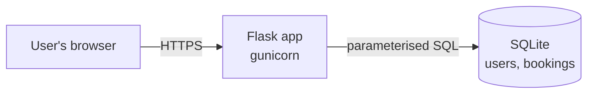
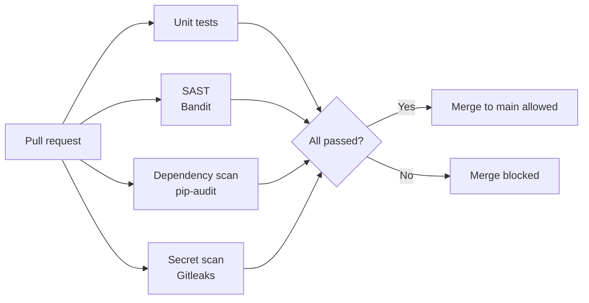

# DevSecOps Portfolio

A small Flask room-booking app, built and secured across the software development lifecycle. Every change goes through an automated security pipeline, and code that fails a security check cannot be merged into `main`.

| Project | Status |
|---|---|
| CI/CD security pipeline | Done |
| Secure app (end to end) | Built, deployment coming |
| Threat model (STRIDE) | Coming |
| Vulnerability find and fix | Coming |

## The app

Users register, log in, book study and meeting rooms, and cancel their bookings.



**Security controls built in**

| Control | How |
|---|---|
| Password storage | Salted hashes (Werkzeug `generate_password_hash`), 12+ character minimum |
| SQL injection | Parameterised queries only |
| XSS | Jinja2 auto-escaping + Content Security Policy |
| CSRF | Flask-WTF token on every form |
| Clickjacking | `X-Frame-Options: DENY` and CSP `frame-ancestors 'none'` |
| Session security | `HttpOnly`, `Secure`, `SameSite=Lax` cookies; session cleared on login |
| Input validation | Allow-listed rooms and slots, date checks, request size limit |
| Secrets | `SECRET_KEY` from environment, never committed |
| Account enumeration | Generic "invalid username or password" message |

## The security pipeline

Runs on every pull request and every push to `main` ([workflow](.github/workflows/security.yml)).



| Check | Tool | Fails the build when |
|---|---|---|
| Unit tests | pytest | Any test fails |
| SAST | Bandit | Medium or high severity issue found |
| Dependency scan | pip-audit | Any dependency has a known CVE |
| Secret scan | Gitleaks | A secret is found anywhere in git history |

**Pipeline hardening**
- Third-party actions pinned to full commit SHAs, not tags, since tags can be moved by an attacker (as in the 2026 trivy-action compromise, CVE-2026-33634).
- Workflow token is read-only by default (least privilege).
- Dependabot opens weekly PRs for dependency and action updates, and each one goes through the same pipeline.
- Branch protection on `main`: changes must go through a PR, and every check must pass.

### Proof it works

[Pull request #2](../../pull/2) added a booking search feature that built SQL with an f-string. Bandit flagged it as SQL injection (B608) and the merge was blocked. The fix switched to a parameterised query and added tests, after which the pipeline passed.

**Blocked:** Bandit fails the build on the SQL injection


**Fixed:** all checks pass after the parameterised query


## Run locally

```bash
python -m venv .venv
source .venv/bin/activate        # Windows: .venv\Scripts\activate
pip install -r app/requirements.txt -r app/requirements-dev.txt
cd app
SESSION_COOKIE_SECURE=false flask --app main run
```

On Windows PowerShell, set the variable first with `$env:SESSION_COOKIE_SECURE="false"`, then run `flask --app main run`.

Then open http://127.0.0.1:5000. Run the tests with `python -m pytest -v` from the `app` folder.

## How this was built

Built with AI assistance (Claude). I directed the build, reviewed every pull request and scan result, and can explain all of the code.
